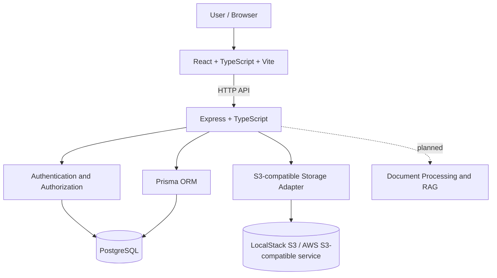
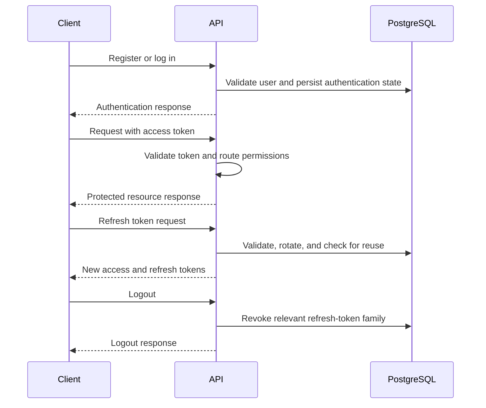

# NimbusVault AI

**A cloud-native file storage and management platform built with React, TypeScript, Express, PostgreSQL, Prisma, and S3-compatible object storage.**

NimbusVault is being developed as a secure, modular file-management platform with authenticated access, folder organization, cloud-style uploads and downloads, collaboration, and a planned AI document-intelligence layer.

> **Project status:** Phase 1 (Foundation & Authentication) is complete. Phase 2 (Cloud Storage & File Management) has been implemented locally and reported passing its current test suite. Phase 3 (Collaboration & Sharing) is in progress. Check the repository and latest test results before treating any feature as production-ready.

## Contents

- [Highlights](#highlights)
- [Current implementation status](#current-implementation-status)
- [Architecture](#architecture)
- [Technology stack](#technology-stack)
- [Getting started](#getting-started)
- [Environment configuration](#environment-configuration)
- [Development commands](#development-commands)
- [Testing and quality checks](#testing-and-quality-checks)
- [API overview](#api-overview)
- [Security notes](#security-notes)
- [Roadmap](#roadmap)
- [Repository structure](#repository-structure)
- [Contributing](#contributing)
- [License](#license)

## Highlights

### Foundation and authentication

- JWT-based authentication with short-lived access tokens.
- Refresh-token rotation and reuse detection.
- Protected backend endpoints and frontend route guards.
- Password hashing and request validation.
- Rate limiting, security headers, CORS configuration, and standardized error handling.
- Structured application logging and health-check endpoints.
- Docker Compose development environment and GitHub Actions CI workflow.

### File and folder management

- S3-compatible object storage through an adapter built on the AWS SDK.
- File upload and download flows, including presigned URLs where supported by the configured storage service.
- File listing, renaming, moving, and deletion.
- Folder creation, listing, hierarchy navigation, renaming, moving, and deletion.
- File metadata and folder navigation in the frontend.
- Local development support using LocalStack instead of requiring an AWS account.

### Planned collaboration and document intelligence

- Registered-user sharing with explicit roles and authorization checks.
- Secure, expiring, revocable share links.
- Activity history and sharing management UI.
- AI-assisted document processing, semantic search, and retrieval-augmented generation (RAG).

Features in the planned sections are not represented as completed until implemented and verified in the repository.

## Current implementation status

| Phase | Scope | Status |
|---|---|---|
| Phase 0 | Architecture and planning | Complete |
| Phase 1 | Foundation and authentication | Complete |
| Phase 2 | Cloud storage and file management | Implemented locally; reported tests passing |
| Phase 3 | Collaboration, sharing, and activity history | In progress |
| Phase 4 | Document processing, semantic search, and RAG assistant | Planned |
| Phase 5 | Infrastructure, deployment, and operational hardening | Planned |
| Phase 6 | End-to-end validation and portfolio release | Planned |

**Phase 2 verification note:** The development report for the current implementation recorded 57 passing backend tests and 7 passing frontend tests, with backend and frontend builds passing. Re-run the commands in this README on your current checkout to verify the state of the code you are using. Passing local tests alone does not establish production readiness.

## Architecture

NimbusVault uses a modular-monolith approach: the frontend communicates with an Express API, which applies authentication and authorization before accessing PostgreSQL or object storage.



The AI layer is a future extension; the diagram does not imply that document processing or RAG is already implemented.

### Authentication flow



Exact request and response shapes should be confirmed against the current API implementation and API documentation.

## Technology stack

| Layer | Technologies |
|---|---|
| Frontend | React 18, TypeScript, Vite, Tailwind CSS, React Router, Axios |
| Frontend testing | Vitest, React Testing Library |
| Backend | Node.js 20+, Express 4, TypeScript |
| Validation and security | Zod, Helmet, express-rate-limit, JWT, bcrypt |
| Data access | Prisma ORM |
| Database | PostgreSQL 16 |
| Object storage | AWS SDK v3 with S3-compatible storage; LocalStack for local development |
| Backend testing | Jest, Supertest |
| Development and CI | Docker, Docker Compose, GitHub Actions |
| Logging | Pino |

The exact package versions are defined by the lockfiles and package manifests in the repository.

## Getting started

### Prerequisites

- Node.js 20 or newer.
- npm (use the package manager and lockfile already present in the repository).
- Docker Desktop with Docker Compose, recommended for the local database and S3-compatible storage.
- Git.

### 1. Clone the repository

```bash
git clone https://github.com/JainMehul05/NimbusVault-.git
cd NimbusVault-
```

### 2. Configure environment variables

Use the example files committed to the repository as the source of truth. Copy them to the local environment files expected by the application, then replace all placeholder secrets with development-only values.

Typical setup:

```bash
# Run from the repository root in a Bash-compatible shell
cp backend/.env.example backend/.env
```

If the frontend has an environment example file, copy that too. On Windows PowerShell, use `Copy-Item` instead of `cp` if needed.

Do not commit `.env` files or real credentials. The exact required variables and defaults are described in [Environment configuration](#environment-configuration).

### 3. Start local dependencies

Inspect `docker-compose.yml` before starting services to confirm the current service names and port mappings.

```bash
docker compose up -d postgres localstack
docker compose ps
```

If your Compose file uses different service names, substitute the names defined there. Wait until the database and storage service report healthy before starting the application.

### 4. Install dependencies

From the repository root:

```bash
npm install
```

If the repository is not configured to install all workspaces from the root, install dependencies in the relevant package directories:

```bash
cd backend
npm install
cd ../frontend
npm install
cd ..
```

Use the repository's existing lockfile and package-manager conventions; avoid mixing package managers in the same working tree.

### 5. Prepare the database

Run the database commands defined by the root or backend `package.json`. Common project scripts may include:

```bash
npm run db:generate
npm run db:migrate
```

Run these only if those scripts exist in the current package manifest. Prefer migrations for reproducible schema setup. `db push` is intended for development workflows where it is explicitly supported, not as a replacement for reviewed migrations.

### 6. Start the application

Use the scripts actually defined in the root `package.json`. In this repository, the intended development workflow is to run the backend and frontend in separate terminals, for example:

```bash
npm run dev:backend
```

```bash
npm run dev:frontend
```

If those root scripts are unavailable in your checkout, use the corresponding scripts from `backend/package.json` and `frontend/package.json`.

### 7. Open the application

The development URLs depend on the current port mappings. The previous local setup used:

- Frontend: `http://localhost:5173`
- Backend API: `http://localhost:3002/api/v1`
- Health endpoint: `http://localhost:3002/api/v1/health`

Confirm the actual values in `docker-compose.yml` and your environment files before relying on these URLs.

## Environment configuration

Environment variable names and defaults can change as the application evolves. Confirm required values in `backend/.env.example`, the frontend environment example, and the application configuration code.

| Variable | Purpose | Notes |
|---|---|---|
| `NODE_ENV` | Runtime environment | Usually `development` locally |
| `PORT` | Backend listening port | Use the port expected by Compose and the frontend |
| `API_PREFIX` | API route prefix | Confirm the expected value in backend routing |
| `DATABASE_URL` | PostgreSQL connection string | Must target the correct local database and port |
| `JWT_ACCESS_SECRET` | Signs access tokens | Use a strong, unique local secret; never commit it |
| `JWT_REFRESH_SECRET` | Signs refresh tokens | Use a separate strong secret |
| `JWT_ACCESS_EXPIRES_IN` | Access-token lifetime | The documented design uses a short-lived access token |
| `JWT_REFRESH_EXPIRES_IN` | Refresh-token lifetime | Confirm the supported format and value |
| `BCRYPT_ROUNDS` | Password-hashing work factor | Use the configured project default |
| `FRONTEND_URL` | Allowed frontend origin / CORS configuration | Must match the local frontend origin |
| `VITE_API_URL` | Frontend API base URL | Must point to the backend API |
| S3-compatible storage variables | Storage endpoint, region, credentials, bucket, path-style setting | Use the exact names in `backend/.env.example` and Compose |

Never use example credentials or development secrets in production. Do not publish secrets in issue reports, screenshots, logs, or commits.

## Development commands

Scripts vary by package and may evolve. Check `package.json` in the root, `backend`, and `frontend` for the authoritative list.

Common workflows include:

```bash
# Run backend tests
cd backend
npm test

# Run frontend tests
cd ../frontend
npm run test:run

# Build the backend
cd ../backend
npm run build

# Build the frontend
cd ../frontend
npm run build
```

For Docker:

```bash
docker compose ps
docker compose logs -f
docker compose up -d
```

Only use a stop/down command when you understand which services and volumes it affects. Avoid `docker compose down -v` unless you deliberately intend to remove the associated volumes and have confirmed that no needed data will be lost.

## Testing and quality checks

Run tests and builds from the current checkout before making claims about project health.

Recommended verification sequence:

1. Backend unit and integration tests.
2. Frontend component tests.
3. Backend and frontend production builds.
4. Linting and type checks, where scripts are available.
5. Storage integration tests against the configured LocalStack/S3-compatible service.
6. End-to-end checks for authentication, upload, download, folder operations, and authorization.
7. Regression checks after each feature milestone.

Current known test categories include:

- Registration and login validation.
- Invalid credentials and duplicate-account handling.
- JWT-protected routes.
- Refresh-token rotation, reuse detection, and logout.
- File and folder API behavior.
- Storage upload/download flows and validation.
- Frontend authentication and file-management interactions.

Test counts and coverage should be updated only after running the relevant commands. A passing test suite is evidence for the tested cases, not proof that every security or production concern is solved.

## API overview

The API is versioned under the configured API prefix. The local setup has previously used `/api/v1`.

Implemented API areas include:

- Authentication and current-user endpoints.
- Health checks.
- File operations, including listing, uploading, downloading, renaming, moving, and deleting.
- Folder operations, including creation, listing, hierarchy navigation, renaming, moving, and deletion.

Routes, request schemas, response shapes, and authorization behavior may change during development. Consult the backend route definitions and API documentation for the exact current contract. Do not assume an endpoint exists merely because it appears in the roadmap.

## Security notes

- Keep secrets in local environment files or a dedicated secrets manager, never in source control.
- Validate all untrusted input on the server.
- Enforce authorization on the backend for every protected resource; frontend route guards are not a security boundary.
- Use least-privilege permissions for database and object-storage credentials.
- Treat presigned URLs as bearer credentials: anyone who obtains a valid URL may be able to use it until it expires.
- Use HTTPS and production-appropriate CORS, cookie, token, logging, and rate-limit settings before deployment.
- Avoid logging passwords, tokens, secret keys, or private file contents.
- Review migrations and backup/restore procedures before applying schema changes to any environment with valuable data.
- Do not treat the current local development configuration as production-ready without a separate security and deployment review.

## Roadmap

### Phase 0 — Architecture and planning
- [x] Requirements and architecture planning
- [x] Initial data model and API planning
- [x] Technology selection and testing strategy

### Phase 1 — Foundation and authentication
- [x] Monorepo and application foundation
- [x] Express, TypeScript, Prisma, and PostgreSQL integration
- [x] React, TypeScript, Vite, and Tailwind frontend foundation
- [x] Registration, login, JWT access tokens, and refresh-token rotation
- [x] Protected routes and request validation
- [x] Error handling, security middleware, logging, and health checks
- [x] Docker Compose and CI workflow
- [x] Initial backend and frontend tests

### Phase 2 — Cloud storage and file management
- [x] S3-compatible storage adapter and LocalStack development support
- [x] File upload/download flows
- [x] File listing, rename, move, and delete operations
- [x] Folder CRUD and hierarchy/navigation operations
- [x] Frontend file-manager and upload/navigation components
- [x] Storage configuration and integration tests
- [ ] Re-audit and explicitly verify file versioning
- [ ] Re-audit and explicitly verify storage quota enforcement
- [ ] Multipart uploads, if required beyond the current upload implementation
- [ ] Final regression and acceptance review

### Phase 3 — Collaboration and sharing
- [ ] Centralized server-side authorization and permission enforcement
- [ ] Owner, Editor, and Viewer permission semantics
- [ ] Registered-user file and folder sharing
- [ ] Shared with Me and Shared by Me views
- [ ] Secure share links with expiry and revocation
- [ ] Safe password protection for share links, if supported by the approved design
- [ ] Activity and audit history
- [ ] Sharing and collaborator-management UI
- [ ] Authorization, privilege-escalation, and regression tests
- [ ] Review of folder permission inheritance and presigned-URL revocation limitations

### Phase 4 — AI document intelligence
- [ ] Document processing pipeline
- [ ] Text extraction for supported document formats
- [ ] Embedding generation and vector storage
- [ ] Semantic search
- [ ] Retrieval-augmented generation (RAG) query engine
- [ ] AI document question-answering interface
- [ ] Evaluation, privacy, and access-control tests for AI retrieval

### Phase 5 — Infrastructure and operations
- [ ] Deployment architecture and environment separation
- [ ] Production secrets and configuration management
- [ ] CI improvements and reproducible builds
- [ ] Observability, operational alerts, and backup/restore verification
- [ ] Deployment and rollback documentation
- [ ] Security and performance review

### Phase 6 — End-to-end validation and portfolio release
- [ ] Full user-flow and cross-user authorization testing
- [ ] Accessibility and responsive-design review
- [ ] Updated screenshots and architecture documentation
- [ ] Accurate feature list and verified test results
- [ ] Final README, setup guide, and release checklist

## Repository structure

The repository is organized around a frontend and backend application. Exact paths can evolve, so use the current checkout as the source of truth.

```text
NimbusVault-/
├── backend/
│   ├── prisma/             # Prisma schema and migrations
│   ├── src/
│   │   ├── common/         # Shared utilities and storage adapter
│   │   └── modules/        # Feature modules and API routes
│   ├── tests/              # Backend tests
│   └── .env.example        # Example configuration (if present)
├── frontend/
│   ├── src/
│   │   ├── components/     # Reusable UI components
│   │   ├── hooks/          # Frontend hooks
│   │   └── pages/          # Application pages
│   └── tests/              # Frontend tests (location may vary)
├── docker-compose.yml
├── package.json
└── README.md
```

## Contributing

Contributions and constructive feedback are welcome.

1. Fork the repository.
2. Create a focused feature branch.
3. Make a small, well-scoped change.
4. Run relevant tests, linting, and builds.
5. Document configuration or API changes.
6. Open a pull request describing the change and verification performed.

Use clear commit messages and never include secrets, local environment files, generated credentials, or private user data.

## License

The previous README states that this project uses the MIT License. Confirm that a valid `LICENSE` file exists in the repository and that its contents match before relying on that statement.

## Links

- **Repository:** https://github.com/JainMehul05/NimbusVault-
- **Issues:** https://github.com/JainMehul05/NimbusVault-/issues
