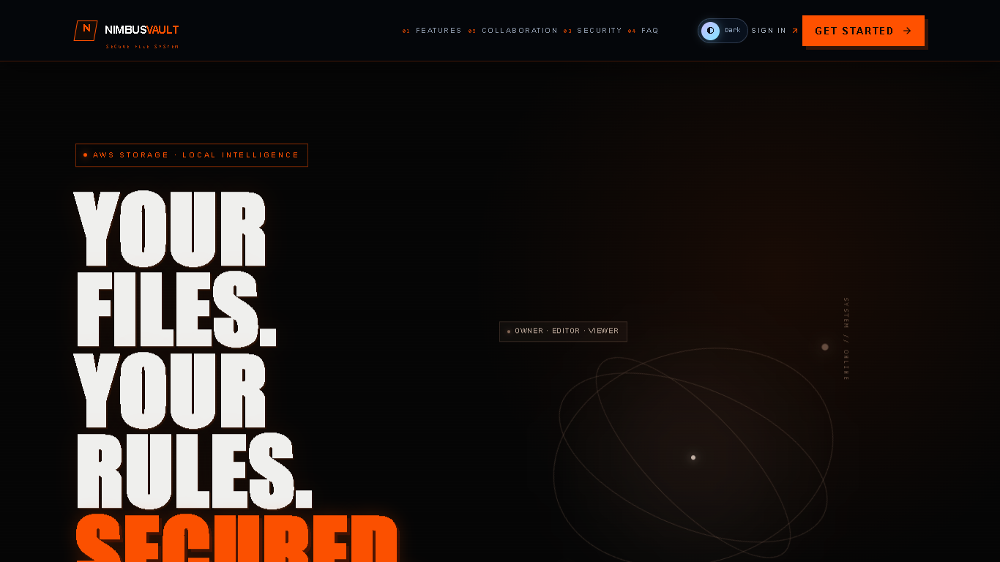
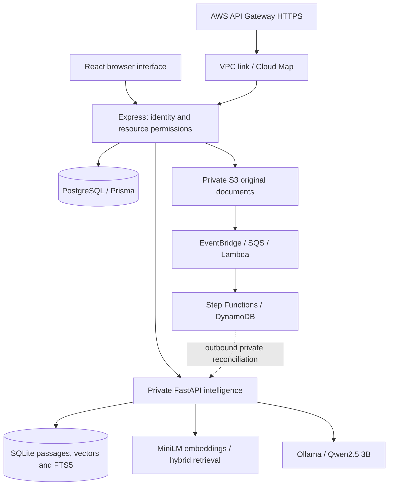

# NimbusVault

**AI-powered cloud storage and document intelligence**, built as a UCS503P university project at Thapar Institute of Engineering and Technology, Patiala.

NimbusVault combines a React file-management interface, Express authentication and permissions, private S3 originals, and a private FastAPI intelligence service. MiniLM embeddings, BM25 and hybrid retrieval find relevant passages; Ollama runs Qwen2.5 3B to answer questions with source citations. The Windows standalone application and the Linux EC2 deployment use the same application source.

**Verified public AWS address:** https://d00xx7hyr7.execute-api.ap-southeast-2.amazonaws.com

The public application is available **only during an explicitly authorized EC2 hosting session**. The latest deployment checkpoint records EC2 stopped; a stopped host returns a service-unavailable response. This is an AWS API Gateway HTTPS endpoint with an AWS-managed certificate. CloudFront distribution creation remains blocked by AWS account verification; no CloudFront website is claimed. See the [public deployment guide](docs/PUBLIC_DEPLOYMENT_GUIDE.md).



## Features

- Registration and login, JWT access tokens, rotating refresh-token families, device sessions and logout/revocation.
- Files and nested folders, uploads/downloads, rename/move, resource permissions and inheritance, sharing, bounded share links, trash and restore.
- Permission-scoped filename, exact, dense semantic, BM25 and hybrid search.
- Local 384-dimensional normalized `all-MiniLM-L6-v2` embeddings; SQLite vectors and FTS5 lexical retrieval.
- Qwen2.5 3B `Q4_K_M` generation through Ollama, multi-document RAG, conversation history, follow-ups and clickable source passages.
- Exact-quotation/source validation, one bounded correction, explicit abstention and visibly labelled extractive fallback. A fallback is not reported as genuine Qwen generation.
- Administrator-only cloud diagnostics; ordinary cached search/Ask uses private retrieval, with a separately guarded optional S3 Vectors demonstration.
- Public-host invite registration, quotas, rate limits and asynchronous answer jobs to accommodate API Gateway request timeouts.
- Windows one-click launchers, Linux containers, persistent backups, bounded AWS sessions and automatic shutdown safeguards.

## Architecture



The cloud workflow performs bounded validation/classification and metadata stages, then ends at an awaiting-local-embedding marker. Private reconciliation, embedding and Qwen generation happen separately on the application host. PostgreSQL owns user permissions; a vector match never grants access to a document.

## Technology stack

| Layer | Implementation |
|---|---|
| Frontend | React, TypeScript, Vite, Tailwind CSS, React Router, Axios |
| Application API | Node.js, Express, TypeScript, Zod, Prisma, PostgreSQL/pgvector |
| Private intelligence | Python 3.13, FastAPI, PyTorch, Sentence Transformers, NumPy, SQLite FTS5 |
| Generation | Ollama, Qwen2.5 3B Q4_K_M; bounded context and concurrency |
| Runtime | Docker Compose, Windows PowerShell/batch, Linux systemd and SSM |
| Tests | Jest, Vitest, pytest, Playwright, infrastructure assertions |
| AWS storage/processing | S3, S3 Vectors, DynamoDB, EventBridge, SQS/DLQ, Lambda, Step Functions |
| AWS hosting/operations | EC2, encrypted EBS, API Gateway, VPC link, Cloud Map, CloudWatch, IAM/STS, Systems Manager/Parameter Store, CloudFormation, EventBridge Scheduler |

The separate CDK infrastructure project is retained as source; its existence does not mean every defined resource is deployed. CloudFront VPC-origin preparation exists, but the distribution is pending account verification. No Kubernetes, RDS, ECS, NAT gateway or load balancer is claimed as part of the accepted deployment.

## Local installation (Windows)

Prerequisites: Node.js 20+ (the workstation was validated with Node 24), Git, Docker Desktop with Linux containers, `uv` with Python 3.13, internet for first installation and sufficient disk/RAM for the models. Complete Docker Desktop/WSL first-run prompts normally.

```powershell
git clone https://github.com/JainMehul05/NimbusVault-.git
cd NimbusVault-
# Start Docker Desktop before first setup.
npm run setup
```

Setup generates private random secrets, installs locked Node/Python dependencies, downloads the pinned portable Windows Ollama runtime when missing, installs/verifies Qwen2.5 3B, applies Prisma migrations and builds the application. MiniLM downloads on its first encoding and is cached inside this project. Review the generated `.env` against [.env.example](.env.example); configure your own approved AWS bucket/account/profile before expecting cloud-backed uploads or storage health to pass. Defaults keep AWS operations/writes disabled. No production data or account credentials are supplied by this repository.

The complete local AI assets are intentionally excluded from Git: the portable Ollama distribution, Qwen weights (about 1.9 GB), MiniLM cache and Python environment. Their installation scripts and dependency locks are included. The source does not need the original CloudVault project directory.

For normal demonstrations, double-click:

| Launcher | Action |
|---|---|
| **Start NimbusVault.bat** | Starts Docker Desktop if needed, waits for database/API/intelligence, checks application readiness, generates a fresh MiniLM embedding, warms Qwen and opens http://127.0.0.1:3100 |
| **Stop NimbusVault.bat** | Drains owned services, unloads model allocations, stops only the local project database and verifies stopped state |
| **Start NimbusVault AWS.bat** | Checks AWS identity/Free-plan credits, asks for bounded session authorization, rearms safeguards, starts the existing approved instance, verifies host/AI/public HTTPS and opens the shareable URL |
| **Stop NimbusVault AWS.bat** | Requests graceful application/OS shutdown and verifies the existing EC2 instance is stopped |
| **NimbusVault Status.bat** | Shows local health, AI readiness, actual AWS instance state, credits, authorized runtime and public availability |

The batch files handle spaces in paths and keep their result windows open. Machine-specific desktop shortcuts are not distributed; use the batch files after cloning. Repeated start does not silently renew AWS authorization; repeated stop preserves data. Never operate a demonstration launcher concurrently with another deployment/test session on the same EC2 instance.

Advanced commands remain available:

```powershell
npm start
npm run warmup
npm stop
npm run backup
npm run build
npm run lint
```

## AWS deployment and operation

The repository contains infrastructure, Linux Dockerfiles, native CPU Ollama extraction, installation/backup scripts, host hardening, public routing and financial safeguards. Deploying requires your own account-specific private configuration, scoped authorization and resource review. Example schemas are under [config/examples](config/examples/README.md); examples are deliberately unapproved and contain no active identifiers or secrets. Do not run provisioning/rehearsal scripts just because they are present.

For the existing approved deployment, use the AWS launchers or:

```powershell
npm run aws:start -- --hours 2
npm run aws:warmup
npm run aws:status
npm run aws:url
npm run aws:stop
```

AWS startup verifies the expected account, an active/unexpired Free plan, credit currency/reserve and a bounded session (at most four hours). It asks for explicit **YES**, writes absolute deadline/credit tags, replaces the independent stop schedule and checks host runtime/deadline/watchdog timers. Missing approval, uncertain credit state or failed readiness fails closed. Credentials use the normal local AWS provider or the EC2 instance role; no access keys or live authorization manifests are in Git.

See [public hosting](docs/PUBLIC_DEPLOYMENT_GUIDE.md), [deployment evidence](docs/AWS_FINAL_DEPLOYMENT_REPORT.md), [security](docs/AWS_DEPLOYMENT_SECURITY.md), [architecture](docs/AWS_DEPLOYMENT_ARCHITECTURE.md), and the [university demonstration guide](docs/UNIVERSITY_DEMONSTRATION_GUIDE.md). Earlier Session A/manual-SSM instructions are historical; Session B public operation supersedes them.

## Security and preservation

Express derives the current readable-file scope; private FastAPI authenticates the internal service token and validates actor/scope. Citations and history are rechecked against current permissions. Passwords are hashed; refresh rotation, CSRF/CORS, origin protection and public quotas are enforced. PostgreSQL, FastAPI and Ollama are not public endpoints. Cloud uploads require the account guard and write authorization; the native event pipeline stays disabled outside approved windows.

Local startup/stop preserves the database volumes, documents and conversation history. Backups, private SQLite/PostgreSQL data, AWS caches, invitation codes, credentials and model distributions are excluded from Git. The donor project's private data and recovery copies are not included or imported automatically. Retained source and license notices credit the CloudVault integration.

Residual risks remain: the retained container scan reports 23 distinct HIGH/CRITICAL CVE identifiers, including one scanner-critical PostgreSQL libxml2 finding with no stable fix in the assessed image. Prompt-injection checks and permission tests cover finite cases; they do not prove universal safety. The application is an academic demonstration, not a production security certification.

## Verification and measured performance

These are retained, scoped results, not newly rerun cloud benchmarks during repository publication:

| Check | Recorded result |
|---|---|
| Latest Session B local regressions | Backend 309, frontend 60, Python 83 plus two Windows real-Qwen tests, infrastructure 22 |
| Public browser checks | 54 responsive route/viewport checks and seven workflows |
| Search regression | 84 synthetic queries: 69 positive, 15 negative; hybrid top-1 69/69, negative rejection 15/15, mean Recall@3 98.55%, MRR 1.0, zero tested scope leaks |
| Strict Qwen evaluation | 40/40: 31 genuine generated answers and nine correct abstentions; retained Session A run, not repeated after the Session B async transport change |
| EC2 performance | About 40–46 s to application readiness; roughly 31 s warm answers and 70.7 s first answer in the recorded CPU run |
| Preservation/lifecycle | Stop/start persistence, recoverable database restore, graceful cancellation and live watchdog/Scheduler stops documented |

The search corpus was used during development; it is not an untouched holdout. Latencies depend on hardware, caching and request path. No coverage percentage, universal accuracy or equivalence between laptop GPU and EC2 CPU is asserted.

Useful local checks (integration suites require isolated test resources):

```powershell
npm run build
npm run lint
npm run test:frontend
npm test --workspace=infra
intelligence\.venv\Scripts\python.exe scripts/test-launcher-aws.py
powershell -NoProfile -ExecutionPolicy Bypass -File scripts/test-launcher-docker.ps1
```

Backend/database suites must use disposable test databases and LocalStack as described in the test configuration; never redirect them at personal application data or live AWS. Expensive AI benchmarks are opt-in and retain frozen expected outputs.

## Project structure

```text
backend/                 Express API, Prisma migrations and tests
frontend/                React application and UI tests
intelligence/            Private FastAPI, extraction/retrieval/RAG and tests
infrastructure/          Existing CloudFormation and Lambda processing source
infra/                   CDK definitions and infrastructure tests
deployment/              Linux containers, host setup and shutdown safeguards
scripts/                 Windows/local/AWS setup, operation and verification
benchmarks/               Synthetic retrieval and AI fixtures
config/examples/          Non-secret, unapproved configuration schemas
docs/                    Current guides, evidence and labelled history
reports/final_project_report/  Completed academic report source/PDF snapshot
*.bat                    Five Windows demonstration launchers
```

## Costs and limitations

Recorded Sydney rates are approximately USD 0.1197/hour for compute, USD 0.005/hour for in-use IPv4 and USD 0.096/GiB-month for gp3. Retained 30 GiB storage is about USD 2.88/month even while stopped. API Gateway, Cloud Map and other requests/storage have separate usage costs. These are documented estimates, not a bill or a permanent-free-hosting promise; verify current rates before a new deployment. Free-plan credits and eligibility expire, billing can lag, and timers are operational safeguards rather than a hard billing cap.

Public registration requires a private invitation code. CPU generation is deliberately single-concurrency and can be slow. OCR, permanent purge, arbitrary public-model endpoints, large-scale load testing and distributed high availability are not accepted capabilities. CloudFront is pending AWS account verification. The optional Groq key-storage helper stores a key privately; it does not establish a verified Groq application integration.

## Documentation and academic report

- [Architecture and source mapping](docs/ARCHITECTURE_FINAL.md)
- [Standalone independence and recovery](docs/STANDALONE_VERIFICATION_REPORT.md)
- [Measured search](docs/EC2_SEARCH_BENCHMARK.md), [Qwen evaluation](docs/EC2_AI_QUALITY_EVALUATION.md), [performance](docs/EC2_PERFORMANCE_REPORT.md)
- [Public deployment guide](docs/PUBLIC_DEPLOYMENT_GUIDE.md) and [demonstration guide](docs/UNIVERSITY_DEMONSTRATION_GUIDE.md)
- [Publication audit](docs/GITHUB_PUBLICATION_REPORT.md)
- [Academic PDF](reports/final_project_report/NimbusVault_Final_Project_Report.pdf) and [editable LaTeX](reports/final_project_report/NimbusVault_Final_Project_Report.tex)

The completed 70-page academic report is a **pre-deployment evidence snapshot** from November 27, 2026; its pending-EC2 statements are historical. The Session A/B deployment reports above supersede that operational status. Its sanitized typesetting sources are included; its virtual environment, raw evidence, build products and duplicate ZIP are not. Earlier `docs/phase-*`, donor notes and inactive workflow examples are labelled historical references.

## Licensing

CloudVault-derived code retains its Apache-2.0 license and notices in `LICENSE.cloudvault` and `NOTICE.cloudvault`. The upstream NimbusVault `LICENSE` is empty, so no new blanket redistribution license is invented. Check the separate Qwen model license before redistribution or use outside its terms. Model weights and executable distributions are not bundled.
