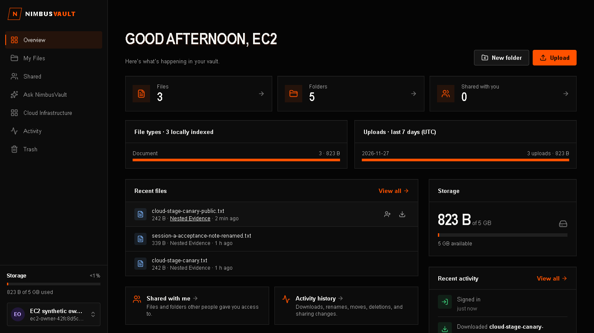
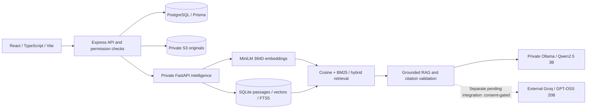
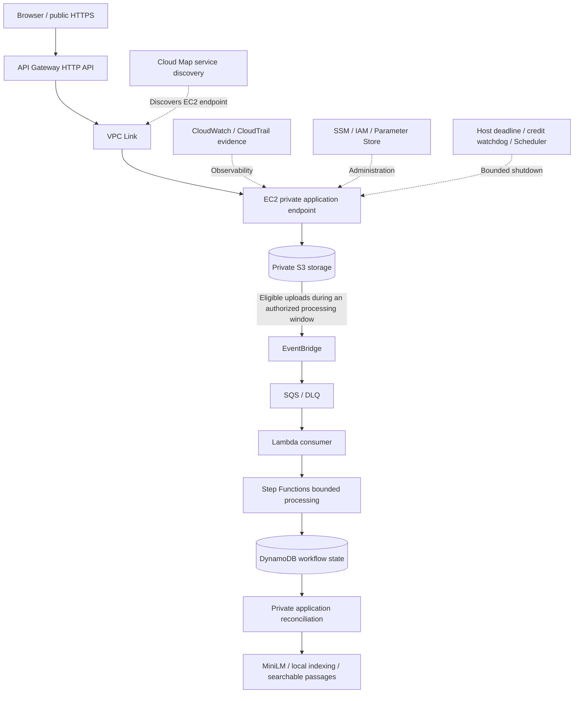
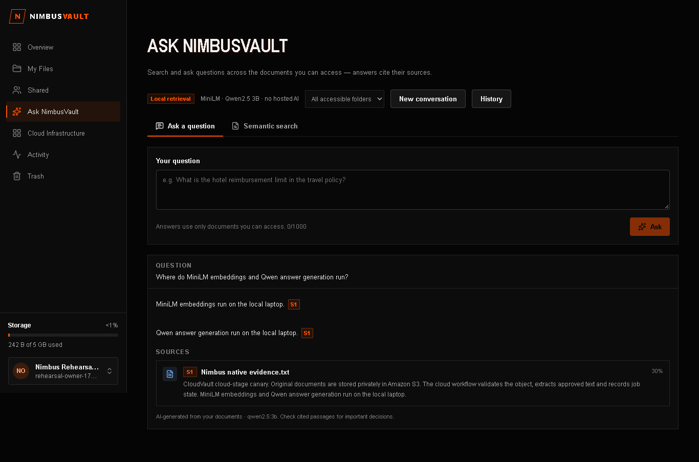
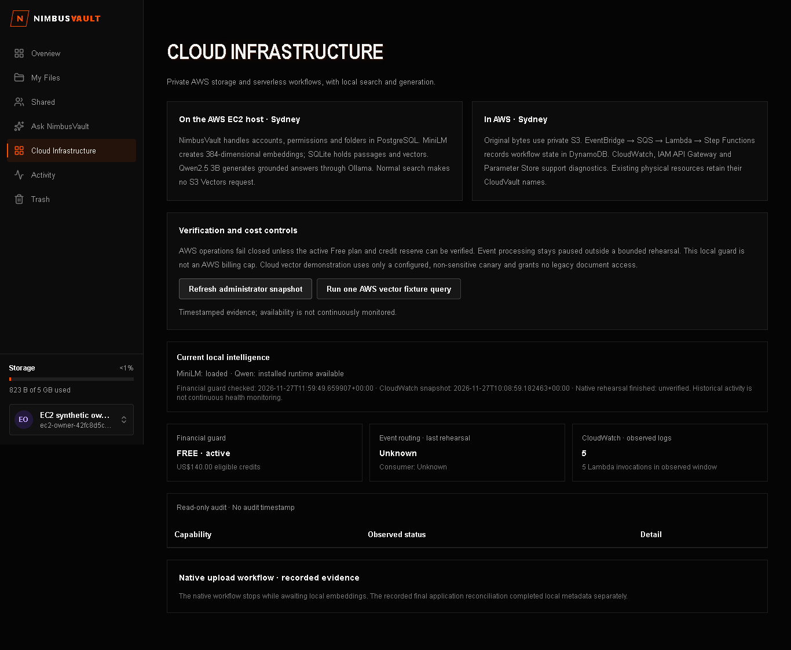

# NimbusVault

**AI-Powered Cloud Storage & Document Intelligence Platform**

Thapar Institute of Engineering and Technology, Patiala
UCS503P — Software Engineering Project, 2026–27 Odd Semester

NimbusVault combines permission-controlled cloud storage with document understanding. Users organize and share files, find relevant passages through semantic and keyword search, and ask questions across accessible documents. Answers link back to source passages so the underlying evidence can be checked.

[Application source](code/) · [Technical documentation](docs/index.md) · [Public deployment guide](docs/PUBLIC_DEPLOYMENT_GUIDE.md) · [Repository audit](docs/FINAL_GITHUB_AUDIT.md)



## Team and supervision

| Roll Number | Student |
|---|---|
| 1024030021 | Saras |
| 1024030020 | Mehul Jain |
| 1024030012 | Mansimar Kaur |

**Supervisor:** Dr. Paramveer Sidhu
Department of Computer Science and Engineering

## Academic submissions

| Submission | Current files |
|---|---|
| [Project proposal](project-proposal/) | [PDF](project-proposal/NimbusVault_Project_Proposal.pdf) · [LaTeX](project-proposal/NimbusVault_Project_Proposal.tex) |
| [Prototype-stage report](project-report-prototype-stage/) | [PDF](project-report-prototype-stage/project-report-prototype-stage.pdf) · [LaTeX](project-report-prototype-stage/project-report-prototype-stage.tex) |
| [Final report](project-report-final/) | Owner-managed directory; currently only `.gitignore`, with no report PDF/source |
| [Team journals](journals/) | [Saras](journals/1024030021-saras/index.md) · [Mehul Jain](journals/1024030020-mehul-jain/index.md) · [Mansimar Kaur](journals/1024030012-mansimar-kaur/index.md) |

Academic directories retain the owner's current GitHub versions unchanged. Genuine authored historical journal entries were unavailable; the journal pages disclose that gap without inventing contributions.

## What the project does

Traditional file storage helps users keep documents but often leaves discovery dependent on filenames and exact keywords. NimbusVault adds retrieval over document contents while preserving ownership, sharing rules and the ability to inspect cited evidence.

| Area | Implemented capabilities in this release |
|---|---|
| Storage | Upload/download, nested folders, dashboard, activity, trash and restore |
| Collaboration | User permissions, folder inheritance, share links and revocation |
| Search | Filename and phrase lookup, semantic similarity, BM25, hybrid ranking and folder filters |
| Document intelligence | Text extraction/chunking, multi-document RAG, conversation follow-ups, source citations and explicit abstention |
| Security | Password hashing, access/refresh tokens, rotation, CSRF/CORS controls, authorization and request limits |
| Cloud | Private S3 originals, bounded native processing, administration views and AWS vector demonstration |
| Operation | Five Windows launchers, readiness/warmup checks, backup tooling and bounded EC2 sessions |

**Release boundary:** published generation uses private Qwen through Ollama. Groq GPT-OSS 20B has a separate local checkpoint; Session C verification is ongoing and its unfinished changes are excluded. See [AI provider status](docs/AI_PROVIDER_STATUS.md).

## Application architecture



The backend determines the documents a user can access. Intelligence retrieves evidence from that scope, builds a bounded context and validates generated claims against cited passages. The dashed external-provider path describes the separate pending integration, not shipped functionality.

## AWS architecture



Cloud Map provides discovery; it is not a network proxy. Native cloud stages validate/process eligible objects and record workflow state; private reconciliation/indexing completes the application search path. Not every upload runs every optional cloud demonstration. Ordinary hybrid search uses local vectors; S3 Vectors is a separate bounded demonstration. CDK and other historical infrastructure source is retained without implying it is all deployed.

**CloudFront was not successfully deployed as a public distribution.** The verified public hosting path uses API Gateway. [Deployment evidence](docs/AWS_FINAL_DEPLOYMENT_REPORT.md) distinguishes Sessions A/B and retained infrastructure from pending work.

## Technology stack

| Layer | Technologies |
|---|---|
| Frontend | React, TypeScript, Vite, Tailwind CSS |
| Backend | Node.js, Express, Prisma, REST APIs and asynchronous AI jobs |
| Databases | PostgreSQL application metadata; SQLite passages, vectors and FTS5 |
| Intelligence | Python, FastAPI, document extraction and chunking |
| Embeddings | `sentence-transformers/all-MiniLM-L6-v2`, normalized 384-dimensional vectors |
| Search | Cosine similarity, BM25 and hybrid ranking |
| Generation | Published: Ollama / Qwen2.5 3B; pending separate integration: Groq / GPT-OSS 20B |
| AWS | EC2/EBS, S3/S3 Vectors, EventBridge, SQS/DLQ, Lambda, Step Functions, DynamoDB, API Gateway, VPC Link, Cloud Map, IAM/STS, SSM, Parameter Store, CloudWatch, CloudTrail and Scheduler |
| Infrastructure | CloudFormation and retained CDK source |
| Deployment | Docker Compose, native Linux EC2 tooling, Windows standalone launchers |
| Testing | Jest, Vitest, pytest, Playwright and frozen synthetic search/RAG benchmarks |

## Search and grounded answers

MiniLM maps passages and queries to normalized vectors; cosine similarity finds semantically related text even when wording differs. BM25 provides lexical matching, while hybrid ranking combines both signals. Retrieval-augmented generation supplies selected passages to Qwen and validates source references and quotations before displaying the answer. Missing support results in a labelled abstention rather than an unsupported claim.

Retrieval and conversations are permission-scoped; revoked access is rechecked. The separate Groq work introduces external processing only under consent controls and persistent provider budgets. Those controls are not claimed as part of the current published application until that integration is finalized.



## Performance and verification

These are finite regression measurements on synthetic corpora, not universal accuracy claims. Expensive AI/cloud benchmarks were not repeated for this documentation audit.

| Evidence | Recorded result | Environment and scope |
|---|---|---|
| Hybrid retrieval | 69/69 positive top-1; 15/15 negatives rejected; Recall@3 98.55%; MRR 1.0 | 84-query EC2 regression; median 6.78 ms, p95 8.13 ms |
| Qwen strict RAG | 40/40: 31 generated answers and nine correct abstentions; zero measured quotation/permission failures | Session A EC2 CPU; median 28.1 s; retained in Session B |
| Public browser checks | 54 responsive checks plus seven workflows | Recorded Session B public HTTPS verification |
| Published-source regressions | Backend 309, frontend 60, Python 83 plus two Windows real-Qwen checks; infrastructure 22 | Retained Session B laptop report, not newly executed counts |
| Separate Groq local benchmark | 40/40; 31 generated, nine abstentions; median 1.24 s, p95 3.6 s | Local checkpoint `caa4548`; excludes pacing waits; not completed Session C or shipped-runtime evidence |

The Groq/local versus earlier Qwen/EC2 median comparison is approximately 22.7× across different environments. It does not establish equivalent public browser-to-answer latency. [Provider status](docs/AI_PROVIDER_STATUS.md), [search results](docs/EC2_SEARCH_BENCHMARK.md), [Qwen evaluation](docs/EC2_AI_QUALITY_EVALUATION.md) and [current audit checks](docs/FINAL_GITHUB_AUDIT.md) record the distinctions.

## Public deployment

**AWS website:** [Open NimbusVault](https://d00xx7hyr7.execute-api.ap-southeast-2.amazonaws.com)

Available during authorized EC2 hosting sessions. The URL is documented deployment evidence, not a promise of current availability. Hosting consumes finite credits; stopped EBS storage also has a continuing cost. No instance is started merely to check repository links.



## Installation and one-click operation

Windows prerequisites: Node.js 22 LTS with npm, Git, `uv`, PowerShell, Docker Desktop with Linux containers and completed first-run setup. Allow sufficient disk space and initial network access for Python dependencies, MiniLM and the portable Ollama/Qwen downloads. Dependencies and model binaries are not stored in Git.

```powershell
git clone https://github.com/JainMehul05/NimbusVault-.git
cd NimbusVault-/code
# Start Docker Desktop for the initial setup.
npm run setup
```

Setup creates private local configuration, installs dependencies and AI runtimes/models, prepares PostgreSQL and migrations, and builds the application. Later starts use the launchers in `code/`:

| Double-click launcher | Purpose |
|---|---|
| `Start NimbusVault.bat` | Start Docker if needed, check services, warm MiniLM/Qwen and open the local application |
| `Stop NimbusVault.bat` | Gracefully stop project services and verify their stopped state |
| `Start NimbusVault AWS.bat` | Check authentication, credits and explicit bounded-session approval; rearm safeguards, start the configured instance and verify the public site |
| `Stop NimbusVault AWS.bat` | Shut down the configured AWS session and verify the stopped instance |
| `NimbusVault Status.bat` | Show local/AI readiness and configured AWS session status |

Local address: [http://127.0.0.1:3100](http://127.0.0.1:3100). All advanced npm commands remain available from `code/`. AWS launchers require appropriate credentials and private deployment/session configuration; a clone does not automatically gain access to an AWS account. Linux EC2 uses native Linux AI binaries and [its deployment procedure](docs/LINUX_STANDALONE_BASELINE.md), not the Windows launchers.

[Detailed setup](code/README.md) · [One-click guide](docs/ONE_CLICK_LAUNCHERS_VERIFICATION.md) · [University demonstration](docs/UNIVERSITY_DEMONSTRATION_GUIDE.md)

## Repository guide

```text
.github/workflows/                 Application CI and university documentation
assets/                            University logos, shared template assets and styles
code/                              Application, tests, infrastructure and operation
  backend/  frontend/  intelligence/
  infrastructure/  infra/  deployment/
  scripts/  benchmarks/  e2e/  samples/  config/
docs/                              Technical guides, evaluations and audit evidence
journals/                          Student journal directories and recovery notices
project-proposal/                  Owner-managed academic submission
project-report-final/              Owner-managed directory; report currently absent
project-report-prototype-stage/    Owner-managed academic submission
.gitattributes  .gitignore         Integrity and publication exclusions
LICENSE  LICENSE.template          Licensing scope and retained upstream attribution
Makefile  mkdocs.yml                Documentation commands and site configuration
pyproject.toml  uv.lock             Reproducible documentation dependencies
README.md
```

The layout follows the [official UCS503P template](https://github.com/tiet-ucs503/ucs503p-202627odd-template). There is one application tree under `code/`. Original notices remain in their applicable locations; [LICENSE](LICENSE) explains scope without inventing a blanket software licence.

## Security, privacy and limits

Authentication, permission checks and private object storage constrain access. Citation validation ties answers to inspectable evidence. Private keys, passwords, runtime manifests, uploads, conversations, database files, installed dependencies and model weights are excluded from Git. External AI consent and provider quotas remain part of the pending integration, not the current release's privacy promise.

AWS starts fail closed when plan/credit/session checks fail. Host deadlines, a credit watchdog and an independent Scheduler stop bound sessions; these controls are not a billing cap. Free-tier/provider quotas, CPU inference latency, single-generation concurrency, residual upstream container CVEs, incomplete historical journals and academic-scale validation remain limitations. CloudFront and completed Session C are not claimed.

## Further documentation

- [Architecture](docs/ARCHITECTURE_FINAL.md) · [API](docs/guides/api.md) · [Database](docs/phase-0/03-Database.md)
- [Public hosting](docs/PUBLIC_DEPLOYMENT_GUIDE.md) · [AWS verification](docs/AWS_FINAL_DEPLOYMENT_REPORT.md)
- [Security](docs/AWS_DEPLOYMENT_SECURITY.md) · [Financial safeguards](docs/AWS_DEPLOYMENT_COST_REPORT.md)
- [AI provider status](docs/AI_PROVIDER_STATUS.md) · [Search evaluation](docs/EC2_SEARCH_BENCHMARK.md)
- [Academic submissions](docs/academic-submissions.md) · [Repository audit](docs/FINAL_GITHUB_AUDIT.md)

Documentation build: `uv sync --locked --extra docs`, then `uv run --locked --extra docs mkdocs build`. GitHub Pages deployment is separately gated by repository settings and `ENABLE_GITHUB_PAGES`; a successful documentation build alone does not mean a Pages site is published.
