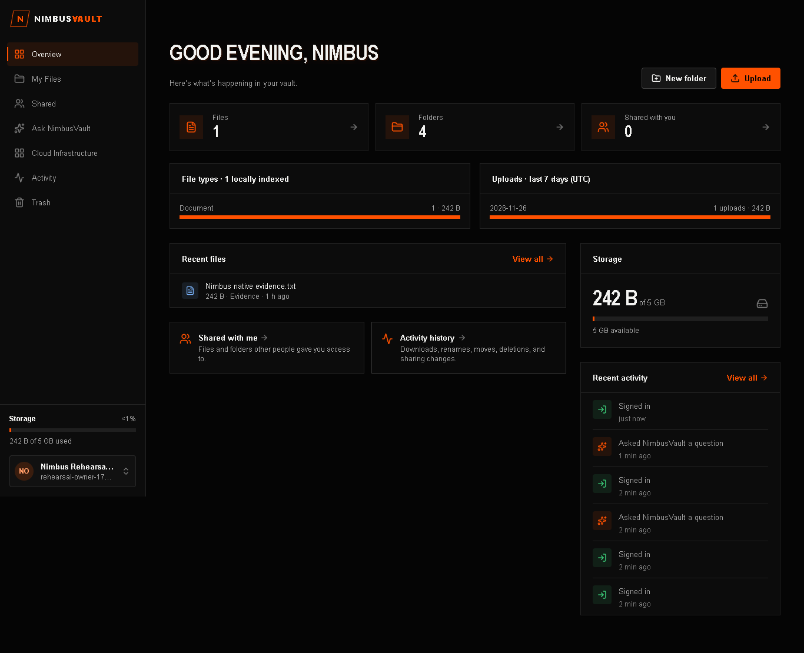

# NimbusVault Final

The original NimbusVault React interface, Express authentication and Prisma application, integrated with CloudVault's guarded AWS storage and local Python intelligence. The final application runs at **http://127.0.0.1:3100**. This is a local Windows application; no hosting deployment is required.



## Run on this laptop

From this folder in PowerShell, with Docker Desktop running:

```powershell
npm start
npm run warmup
```

Open http://127.0.0.1:3100 and register or sign in with your own account. There is no published administrator password. Warmup loads the existing MiniLM and Qwen models locally and makes no AWS requests. First model load can take substantially longer than a warm answer.

```powershell
npm stop
npm run backup
```

Stop affects only recorded processes whose PID and start time match, and the isolated PostgreSQL container. It preserves all database volumes. Backups go to the ignored, private `.private-backup` directory.

For first setup or dependency repair use `npm run setup`. It preserves an existing `.env`, installs locked dependencies, starts the isolated database, applies migrations and builds the application. Prerequisites: Node 20+ (validated with 24), uv/Python 3.13, Docker Desktop, sufficient disk space for local models. The current laptop reuses existing model caches; source code and application databases are independent of the donor project. See [handover](docs/FINAL_HANDOVER.md) before moving to another laptop.

## Features and controls

- Existing NimbusVault registration, login, refresh rotation, logout, account management and sessions.
- Private AWS originals through guarded multipart uploads (25 MiB), downloads with integrity checks, folders, rename/move, sharing/revocation, trash and restore.
- Owner-scoped dashboard statistics, activity, file insights and search.
- Local normalized 384D MiniLM embeddings, exact/filename/semantic/hybrid search, FTS/BM25 evidence, Qwen2.5:3b Q4_K_M answers, source passages, history, follow-ups and Stop.
- Rechecking authorization before returning results, citations and historical answers. Administration does not grant document access.
- Visible abstention and cited extractive fallback when evidence or generation is insufficient.
- Administrator diagnostics for existing CloudVault resources. A fixed optional S3 Vectors demonstration is separate from normal search.

Original CloudVault documents and history remain preserved and **unassigned**. They are not automatically imported into any new account. The final runtime contains new application data and must also be treated as private.

## Cloud and cost controls

The supported AWS configuration is the existing `default` profile in `ap-southeast-2`. Credentials are resolved locally, never embedded in source. Run `aws login --profile default` yourself when authentication expires. No account upgrades, new resources or paid AI services were introduced.

Cloud operations fail closed unless the approved account, active Free plan and USD 1 reserve can be verified. Observed balances are historical evidence, not a promise of future availability. The user's requirement is zero out-of-pocket expenditure: do not upgrade the account or bypass the guard. Normal cached retrieval and generation make no AWS calls. Set `AWS_OPERATIONS_ENABLED=false` to pause cloud access.

The one approved native AWS rehearsal is complete; EventBridge and its SQS consumer were restored to their prior disabled states. **Do not repeat cloud mutations or enable the pipeline without fresh authorization.** New uploads remain usable with local indexing while the native pipeline is idle. Permanent deletion, empty-trash purge and presigned uploads are disabled to protect original objects. Standalone summaries and OCR are not enabled; Ask provides grounded answers for extracted text.

## Documentation

- [Final handover](docs/FINAL_HANDOVER.md)
- [Architecture and source mapping](docs/ARCHITECTURE_FINAL.md)
- [Verification and limitations](docs/VERIFICATION_FINAL.md)
- [Security, migration and rollback](docs/SECURITY_AND_PRESERVATION.md)
- [Existing AWS inventory](docs/AWS_RESOURCE_INVENTORY.md)
- [Evaluation and viva](docs/EVALUATION_AND_VIVA.md)
- [Resume checkpoint](RESUME_CHECKPOINT.md)

Historical upstream documents under `docs/phase-*`, `docs/release` and `docs/donor-cloudvault`, and the old root Docker Compose describe donor architectures. Supported final entry points are `scripts/start.ps1`, `compose.local.yml` and `intelligence/app/internal.py`. The production deploy workflow is an inactive example under `docs/inactive`; nothing was deployed. Infrastructure source is retained for traceability, not permission to provision it.

## Licensing

CloudVault-derived code retains Apache-2.0 license and notices in `LICENSE.cloudvault` and `NOTICE.cloudvault`. NimbusVault's upstream LICENSE is empty; no redistribution license is asserted. Qwen2.5:3b reports the Qwen Research License, which must be reviewed separately before redistribution or different use. Models and private runtime data are excluded from Git.
