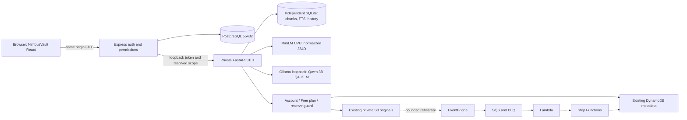
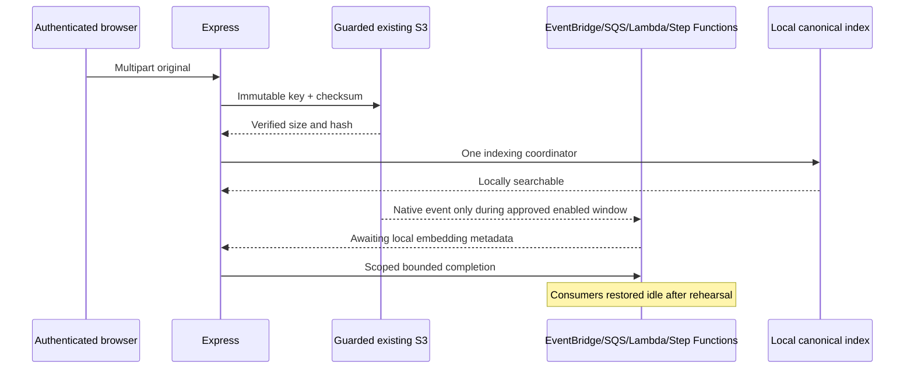
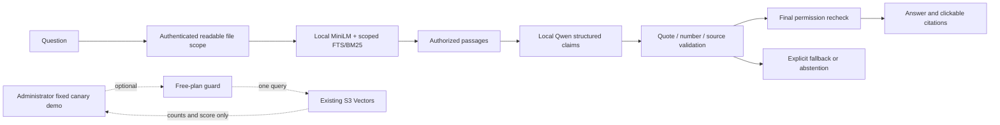

# Final architecture

The browser never receives the internal token or calls Python directly. PostgreSQL is authoritative for accounts, sessions, ownership, shares, trash and indexing jobs. One active indexing coordinator uses the canonical Python extraction/chunking/embedding path. SQLite is independent of the donor database. No second embedding worker or alternative browser application is launched.

## File lifecycle

Authenticated multipart upload allocates an immutable UUID/object key. The guarded adapter writes with `IfNoneMatch=*`, AES256 and SHA256, then verifies size/checksum before finalizing. The same UUID identifies PostgreSQL metadata, SQLite chunks and AWS metadata. The coordinator downloads that original, extracts bounded text and embeds canonical chunks. Reindexing retains unchanged passage IDs and rejects changes to original identity/hash.

Rename and move alter logical placement, not original bytes. Existing NimbusVault folder inheritance applies. Trash removes retrieval access; restore schedules indexing again. Permanent deletion is blocked. Native AWS reconciliation is a bounded administrative action. The EventBridge rule and SQS mapping are idle after rehearsal.

## Retrieval and generation

Express resolves readable READY/INDEXED file IDs and validates requested subsets. Python filters that scope before lexical ranking and vector scoring. Empty scope yields no evidence. Filename, exact, semantic and hybrid modes are distinct. Hybrid combines lexical evidence and cosine similarity. Bounded multi-clause retrieval covers multiple authorized topics; strong lexical matches can rescue rare terms under an explicit cosine floor. Ordinary search never uses AWS vectors.

Qwen receives authorized passages, the question and scoped history. Structured claims require exact quotations and source labels. Validation checks labels, quotations, numbers, lexical/semantic support and invented purpose relationships. A uniquely matching exact quote can repair a known source-label mix-up; unknown labels remain invalid. At most one correction is attempted, retaining only verified claims. Failed validation becomes a labeled extractive fallback; unsupported questions abstain. This reduces unsupported claims but is not a formal entailment guarantee.

Express rechecks all sources before releasing the whole answer. History is actor-owned and withheld if original scope becomes unavailable. Historical citations resolve exact current passages after reindexing. Stop cancels only the actor's request, does not save completed history and releases the generation slot.

## Source mapping

| Component | Origin / responsibility |
|---|---|
| `frontend/` | Actual NimbusVault React/Vite interface, extended in its visual system |
| `backend/` auth, folders, sharing, sessions | Existing NimbusVault application and permissions |
| `backend/src/common/intelligence.ts` | New private connector and transport boundary |
| `backend/src/modules/ai/local-intelligence.ts` | New scope, rechecks, history, cancellation |
| `backend/src/modules/ai/indexing.service.ts` | Existing coordinator, Python integration branch |
| `backend/src/common/storage.ts` | Existing interface, guarded Python adapter in final mode |
| `intelligence/app/internal.py` | New authenticated service, only running Python entry point |
| `intelligence/app/` extraction, embeddings, retrieval, rag, llm, cloud, storage, guard | Selected CloudVault modules, integrated and repaired |
| `infrastructure/` | Existing deployed CloudVault source, preserved |
| `infra/` | NimbusVault donor infrastructure, static tests only |
| `scripts/` | Final lifecycle, backup, audits and verification |

NimbusVault foundation: `06bccdf` (`main` and `phase-5-production-readiness`). CloudVault foundation: `5f2e2ba389fc45923f756794780661f64f994fac`. No donor repository was repurposed as the final application.
