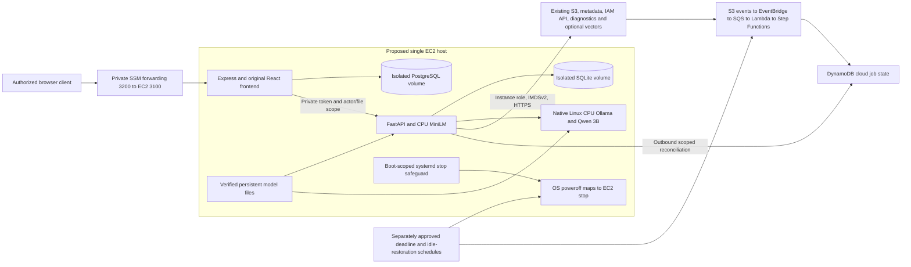

> **Deployed 27 Nov 2026 (Session A).** As-built diagram, networks and evidence: `AWS_FINAL_DEPLOYMENT_REPORT.md` §3 and `AWS_CLOUD_ACCEPTANCE_MATRIX.md`. Differences from the plan below: 30 GiB volume (user choice), AWS CLI v2 installed with signature check, absolute tag-based deadline added, sshd disabled, thin patch layers for the evidence-path and EC2-label fixes.

# Prepared AWS architecture — not yet provisioned

One proposed `m7i-flex.large` in Sydney, official Canonical Ubuntu 24.04 x86-64, encrypted 30 GiB gp3, an existing default VPC/public subnet, no inbound security-group rules and outbound HTTPS. A temporary automatically assigned IPv4 provides outbound connectivity without a NAT gateway; no Elastic IP, ALB, ECS, ECR or RDS is proposed. Actual AMI/VPC/subnet identifiers are in the private resource proposal.

The diagram is a prepared design, not evidence of deployed resources. Neither the Windows laptop nor either original CloudVault directory is a computational dependency. The laptop is an administration/browser/backup client only. Windows frontend, backend, databases, model store and commands remain an independent fallback.

## Container and network boundaries

`deployment/compose.ec2.yml` runs the production frontend through Express, PostgreSQL, authenticated FastAPI and native CPU-only Ollama. PostgreSQL and model networks are internal and have no published ports. Only Express publishes a host-loopback port. An access bridge is necessary because Docker did not publish a port for an internal-only API network in the local rehearsal.

On the approved EC2 host, `restrict-metadata.sh` allows the dedicated intelligence egress network to reach IMDS and rejects metadata from other Docker networks. It also blocks new API outbound connections; API responses and private database/intelligence communication remain allowed. The script refuses to run on Docker Desktop and must be verified on EC2. `nimbusvault.service` creates the networks, applies these rules, then starts services. IMDSv2 is mandatory; hop limit two is proposed for the intelligence bridge. No application container has the Docker socket, host privileges or personal AWS credentials.

The images run as non-root with dropped capabilities, read-only root filesystems, bounded tmpfs, bounded logs, memory limits and a single CPU model slot. Production runtime images exclude tests/dev tools where practical; isolated regression tools use a separate image and separate PostgreSQL/LocalStack project. LocalStack is never AWS acceptance evidence.

## Persistent storage and sizing

Persistent named volumes hold PostgreSQL and SQLite. Controlled read-only bind mounts hold platform-independent MiniLM and Qwen assets. Native Linux Ollama is built from the official release with its complete archive digest checked, selecting 34 CPU/common runtime files and excluding GPU libraries. No Windows exe, DLL, venv, database or personal conversation is deployed.

Local measurements show a compact CPU runtime and approximately 2.2 GiB resident Qwen memory with the model loaded; MiniLM's offline initialization took approximately 6.7 seconds in a fresh local Linux process. These are Docker-on-laptop observations, not EC2 results. Record image/archive sizes, allow OS/Docker/data/log/transfer headroom, and require adequate free disk before long tests. Increase the proposed disk or host only through an explicit revised proposal if measurements show 30 GiB/8 GiB insufficient.

## AWS responsibility

Existing S3 remains authoritative for originals. Existing DynamoDB, native event routing/queue/function/workflow, API Gateway, logs/metrics, Standard parameters and optional S3 Vectors are reused. The normal Linux search/Ask paths are local-to-EC2 MiniLM and Qwen and make zero vector-service queries. New acceptance users, object UUIDs, database rows and conversations are synthetic and isolated; original private documents and history are not automatically migrated.

The planned access URL is private SSM forwarding at `http://127.0.0.1:3200`; it is **not a public HTTPS website**. Production config permits only the explicit loopback client origin. Cookies/CORS/CSRF/origin behavior must be tested over the actual tunnel after approval.
