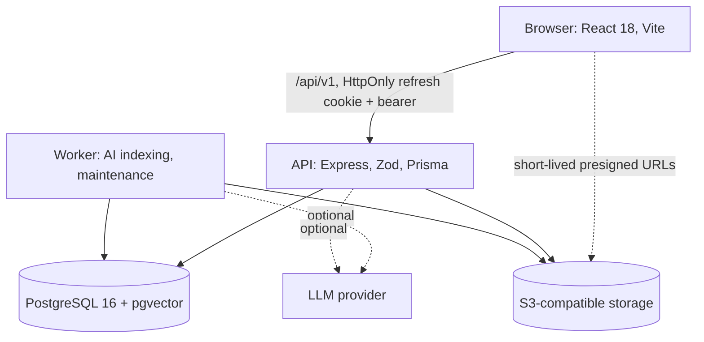

# Architecture

A modular monolith in TypeScript: one React single-page app, one Express API, one background worker, PostgreSQL and S3-compatible storage.

| Path | Contents |
|---|---|
| `backend/src/modules/auth` | Registration, sign-in, sessions, refresh rotation, CSRF, throttling |
| `backend/src/modules/files` | Uploads (direct and presigned), quota, listing, download |
| `backend/src/modules/folders`, `trash` | Folder tree; restore and purge |
| `backend/src/modules/sharing`, `share-links` | Roles; public links |
| `backend/src/modules/activity` | Audit feed |
| `backend/src/modules/ai` | Extraction, OCR, embeddings, search, answers, worker ([details](../phase-4/ai-document-intelligence.md)) |
| `backend/src/modules/maintenance` | Expired uploads, trash retention, token cleanup, quota reconciliation |
| `backend/src/common` | Authorization, storage, locks, names, content checks, errors, logging |
| `backend/src/main.ts`, `worker.ts` | API and worker entry points |
| `frontend/src` | Pages, components, services |
| `e2e` | Playwright suite |
| `infra` | AWS CDK |

## Key mechanisms

**Sessions.** A sign-in creates a session whose id is the refresh-token family and the `sid` in every access token. Access tokens (15 min) live in memory; the refresh token is an HttpOnly, SameSite=Strict cookie limited to `/api/v1/auth`. Every request checks that the session is active, so sign-out and revocation are immediate. Replaying a used refresh token ends the session; two tabs refreshing at once do not.

**Authorization.** `common/authorization.ts` is the single source: owner, or the strongest grant on the item or any ancestor. Resources you cannot see are 404. Vector search applies the same rule inside the SQL query and re-checks before returning anything.

**Uploads.** Quota is reserved with one conditional `UPDATE` before any byte is accepted, and refunded exactly once on failure. Presigned uploads write only to `staging/`; completion verifies size, content and checksum, then copies to an unguessable permanent key the client can never write.

**Trash.** Deleting frees quota and hides everything at once (including from search and links). Items deleted together share a timestamp and restore together. Purging removes the object before the record, so nothing is orphaned.

**Concurrency.** Conditional updates for quota, download limits, rotation and job claims; per-owner advisory locks for folder-tree and name rules; `FOR UPDATE SKIP LOCKED` for the job queue.
