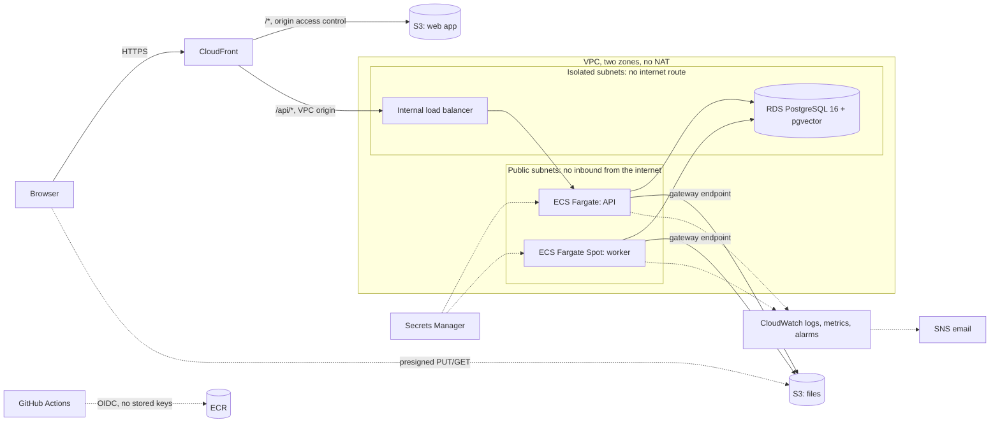

# AWS architecture

Defined as code in [`infra/`](https://github.com/JainMehul05/NimbusVault-/tree/main/infra) (AWS CDK, TypeScript). **Nothing has been provisioned**: the project has no AWS account yet. The definitions are synthesized, unit-tested, checked against the AwsSolutions security rules and linted on every push; they have never been deployed.

## Why CDK

The repository had no infrastructure code; Terraform appears once, as a stretch idea in the Phase 0 team document. CDK was chosen because it uses the project's own language and, with no AWS account, can still be fully synthesized, tested and linted on a developer machine.

## Decisions

| Decision | Reason |
|---|---|
| One CloudFront distribution for the app **and** `/api/*` | Same origin: the refresh cookie can be `SameSite=Strict`, no CORS in production, one certificate |
| Internal ALB behind a CloudFront **VPC origin** | The API has no public address at all, so CloudFront cannot be bypassed |
| No NAT gateway | Saves about $65 a month. Tasks sit in public subnets with public IPs for outbound calls; their security groups accept traffic only from the load balancer |
| Isolated subnets for ALB and RDS | No route to or from the internet |
| Separate API and worker services from one image | Indexing load never competes with requests; the worker can run on Spot because jobs are durable and resumable |
| Embedding model baked into the image | Production downloads nothing at runtime; document text never leaves the VPC for indexing or search |
| Migrations as a one-off task before each rollout | A failed migration leaves the running version untouched |
| Secrets injected by ECS from Secrets Manager | None in images, templates or environment files |
| S3 access through the task role | No access keys exist anywhere |

## Stacks

| Stack | Contents |
|---|---|
| `NimbusVault-<env>-Foundation` | ECR repository (scan on push, immutable tags, 20 images kept) · GitHub OIDC provider and deploy role |
| `NimbusVault-<env>-Platform` | Network, Ingress, Edge, Data, Service, Monitoring (one file each in `infra/lib`) |

## Security controls

- **S3 files**: private, TLS 1.2+, SSE-S3, versioned, CORS limited to the site, access logs, `staging/` objects expire after a day, abandoned multipart uploads after a day, noncurrent versions after 30 days.
- **RDS**: private, encrypted, `rds.force_ssl`, certificate verified by the application, 14-day backups with point-in-time recovery, deletion protection and a final snapshot (production).
- **Containers**: unprivileged user, read-only root filesystem, no shell access (`ECS Exec` off).
- **IAM**: application role limited to object operations on one bucket; deploy role assumable only by this repository's protected GitHub environment.
- **Edge**: HSTS, strict CSP, HTTPS only, optional WAF (`-c enableWaf=true`).

Deliberate deviations from the AwsSolutions rules are listed with reasons next to the resources they concern (search for `accept(` in `infra/lib`); any other finding fails `cdk synth`. The notable ones: no edge/ALB access logs (share-link tokens appear in URLs), no scheduled secret rotation (runbook instead), single-AZ database and no WAF by default (cost).

## Scaling limits to know about

- Rate limits are counted per API task, so with N tasks a client may get up to N times the limit.
- `db.t4g.micro` allows roughly 80 connections; each task uses at most 8.
- Uploads through the API are capped at 100 MB. Presigned uploads bypass the API but use the same cap.
